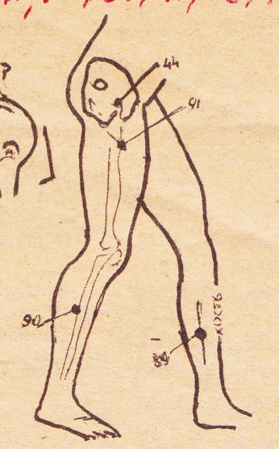
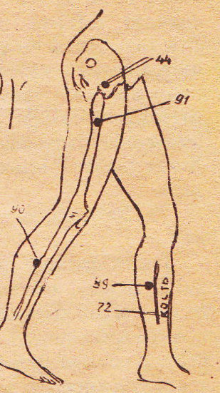

# 89 — Нарушение психики, гипофиз.

**Сегмент:** [Руки і ноги — Точки надавливания на руках и ногах](_segment.md) · **Джерело:** стор. 19 (PDF стор. 17)

## Опис

Это место расположено на внутренней стороне больших мышц нижней части ног. Если оно болезненно, применяйте его для лечения гипофиза и "спутанного мышления". Почти все молодые люди, принимающие наркотики, будут чувствовать боль в этом месте.

## Зображення

*Ноги: 44, 91, 90, 89* — малюнок біля опису, стор. 19

*Тело спереди: сводная схема* — зведена схема, стор. 17

*Ноги: 44, 91, 90, 89, 72* — зведена схема, стор. 17

## У покажчику («Указатель»)

- Атаксия
- Глухота
- Головокружение
- Злоупотребление лекарствами
- Эмоциональный желудок
- Эмоции
- Эпилепсия
- Печальное настроение
- Умопомешательство
- Память
- Психика
- Нервозность
- Гипофиз

→ [Повний покажчик](../kody/ukazatel.md)
