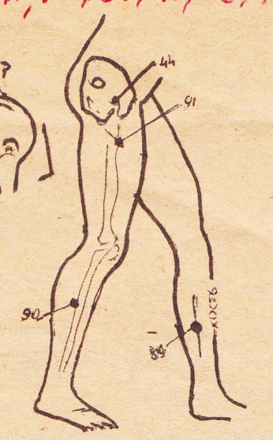
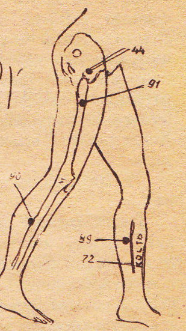

# 90 — Боли в бедрах и ногах, гормоны, напряженность.

**Сегмент:** [Руки і ноги — Точки надавливания на руках и ногах](_segment.md) · **Джерело:** стор. 19 (PDF стор. 17)

## Опис

Это место расположено приблизительно там же, где ["89"](89.md), но на внешней стороне ног на большеберцовой кости. Надавливание на это место, а также на точку ["56"](../03-tulub/56.md) (стр. 11) с обеих сторон тела помогает снять напряженность, избавляет от болей в бедрах и ногах, а также полезно для выработки гормонов размножения.

## Зображення

*Ноги: 44, 91, 90, 89* — малюнок біля опису, стор. 19

*Тело сзади: сводная схема* — зведена схема, стор. 17

*Ноги: 44, 91, 90, 89, 72* — зведена схема, стор. 17

## У покажчику («Указатель»)

- Атаксия
- Кости
- Костный мозг
- Гормоны
- Импотенция
- Половые органы
- Секс

→ [Повний покажчик](../kody/ukazatel.md)
