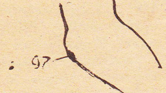
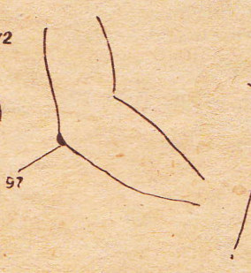

# 97 — Контроль за содержанием сахара.

**Сегмент:** [Руки і ноги — Точки надавливания на руках и ногах](_segment.md) · **Джерело:** стор. 18 (PDF стор. 16)

## Опис

Расположена под локтевым выступом на конце локтевого сустава. Чтобы легче было найти точку, сначала согните локоть. Эти точки связаны с паращитовидными железами и помогают контролировать содержание сахара, а также вырабатывать инсулин. Лечат диабет и гипогликемию.

## Рукописні нотатки власника

- У покажчику біля «Гипогликемия-97» дописано від руки: «перед діабетичний стан».

## Зображення

*Локоть: 97* — малюнок біля опису, стор. 18

*Тело сзади: сводная схема* — зведена схема, стор. 17

*Локоть: 97* — зведена схема, стор. 17

## У покажчику («Указатель»)

- Диабет
- Гипогликемия
- Инсулин

→ [Повний покажчик](../kody/ukazatel.md)
