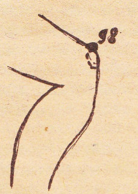
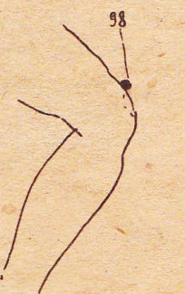

# 98 — Сердечная лимфа, нарушение функции колен.

**Сегмент:** [Руки і ноги — Точки надавливания на руках и ногах](_segment.md) · **Джерело:** стор. 19 (PDF стор. 17)

## Опис

Расположена в мягкой ткани за средневерхним гребешком коленной чашки. Боль в этом месте может указывать на неправильное функционирование коленной чашки с последующей потерей лимфы сердцем или нарушением функции самого колена.

## Зображення

*Колено: 98* — малюнок біля опису, стор. 19

*Тело спереди: сводная схема* — зведена схема, стор. 17

*Колено: 98* — зведена схема, стор. 17

## У покажчику («Указатель»)

- Кости
- Сердце: стопа
- Колени
- Коленная чашка

→ [Повний покажчик](../kody/ukazatel.md)
