# Руки і ноги — Точки надавливания на руках и ногах

Сторінки джерела: 17–20.

## Точки

| Код | Заголовок | Стор. | Малюнків |
|---|---|---|---|
| [97](97.md) | Контроль за содержанием сахара. | 18 | 3 |
| [79](79.md) | Энергия, напряжение. | 18 | 3 |
| [82](82.md) | Кровообращение в предплечьях и в кистях рук. | 18 | 3 |
| [20](20.md) | Боли в руках, шее, голове, желудке, повышенная кислотность. | 18 | 3 |
| [71](71.md) | Толстая кишка, боли в ногах. | 18 | 3 |
| [74](74.md) | Мышцы. | 18 | 3 |
| [69](69.md) | Боль, растяжение сустава. | 18 | 3 |
| [72](72.md) | Толстая кишка. | 18 | 4 |
| [55](55.md) | Кишечник. | 18 | 3 |
| [73](73.md) | Лимфа брюшной полости, диабет, глаза, стопы ног. Мышцы, щитовидная железа. | 18 | 5 |
| [43](43.md) | Брюшная полость, головокружение, ноги. | 18 | 3 |
| [98](98.md) | Сердечная лимфа, нарушение функции колен. | 19 | 3 |
| [44](44.md) | Запор, подвздошные кости, кишечник, растяжение суставов, напряженное состояние. | 19 | 5 |
| [91](91.md) | Толстая кишка. | 19 | 3 |
| [87](87.md) | Кишечник, ожирение. | 19 | 2 |
| [90](90.md) | Боли в бедрах и ногах, гормоны, напряженность. | 19 | 3 |
| [89](89.md) | Нарушение психики, гипофиз. | 19 | 3 |
| [41](41.md) | СОМАТИЧЕСКАЯ. Застой крови, стопа, энергия. | 19 | 3 |
| [40](40.md) | Энергия, воспаление. | 19 | 2 |
| [75](75.md) | Дыхание, селезенка, поджелудочная железа. | 19 | 2 |
| [42](42.md) | Глаза. | 19 | 3 |
| [57](57.md) | Сужение канала мочевого пузыря и мочеточника, судороги. | 20 | 3 |
| [83](83.md) | Сумка на наружной стороне большого пальца ноги (от изменения формы пальца и давления тесной обуви), подагра, простата, органы размножения. | 20 | 2 |
| [58](58.md) | Дыхание, легкие, гипофиз. | 20 | 2 |
| [85](85.md) | Запор, подвздошные кости, легкие, слизистая. | 20 | 3 |

## Рукописні переліки точок угорі сторінок (червоним)

- стор. 18: 97, 79, 82, 20, 71, 74, 72, 55, 73, 43, 69
- стор. 19: 98, 44, 91, 87, 90, 89, 41, 42, 40, 75
- стор. 20: 57, 83, 58, 85

## Зведені схеми

*Тело спереди: сводная схема* (стор. 17) — точки: [44](44.md), [91](91.md), [98](98.md), [73](73.md), [89](89.md), [72](72.md), [41](41.md), [42](42.md), [57](57.md)

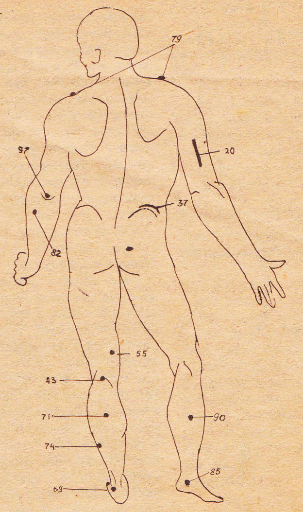

*Тело сзади: сводная схема* (стор. 17) — точки: [79](79.md), [20](20.md), [97](97.md), [82](82.md), [55](55.md), [43](43.md), [71](71.md), [74](74.md), [69](69.md), [90](90.md), [85](85.md)

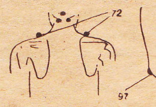

*Плечи: 79 (на схеме подписано «72»)* (стор. 17) — точки: [79](79.md)

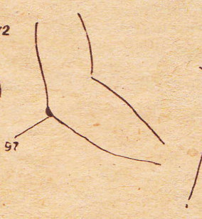

*Локоть: 97* (стор. 17) — точки: [97](97.md)

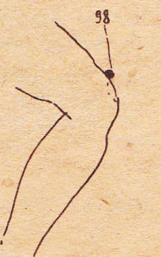

*Колено: 98* (стор. 17) — точки: [98](98.md)

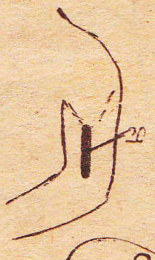

*Плечевая кость: 20* (стор. 17) — точки: [20](20.md)

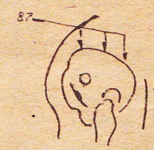

*Гребень бедренных костей: 87* (стор. 17) — точки: [87](87.md)

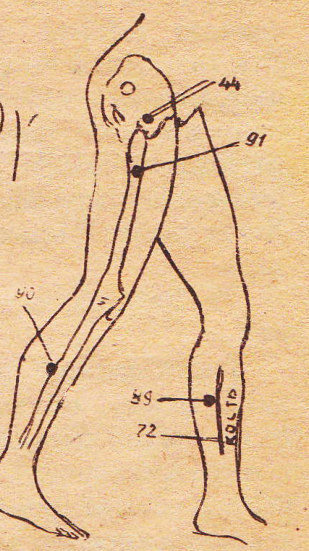

*Ноги: 44, 91, 90, 89, 72* (стор. 17) — точки: [44](44.md), [91](91.md), [90](90.md), [89](89.md), [72](72.md)

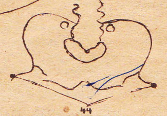

*Таз: 44* (стор. 17) — точки: [44](44.md)

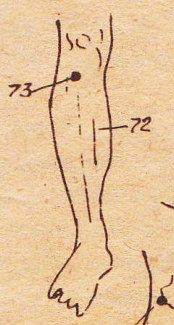

*Голень: 73, 72* (стор. 17) — точки: [73](73.md), [72](72.md)

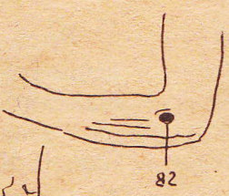

*Предплечье: 82* (стор. 17) — точки: [82](82.md)

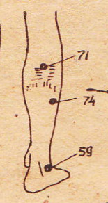

*Голень сзади: 71, 74, 69 (на схеме подписано «59»)* (стор. 17) — точки: [71](71.md), [74](74.md), [69](69.md)

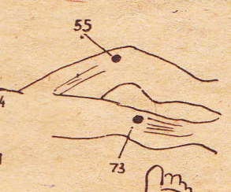

*Бедро и голень: 55, 73* (стор. 17) — точки: [55](55.md), [73](73.md)

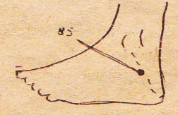

*Стопа: 85* (стор. 17) — точки: [85](85.md)

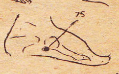

*Стопа сбоку: 75* (стор. 17) — точки: [75](75.md)

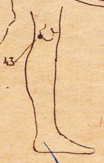

*Под коленом: 43* (стор. 17) — точки: [43](43.md)

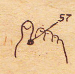

*Пальцы ног: 57* (стор. 17) — точки: [57](57.md)

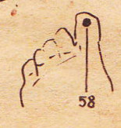

*Большой палец ноги: 58* (стор. 17) — точки: [58](58.md)

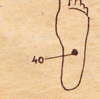

*Подошва: 40* (стор. 17) — точки: [40](40.md)

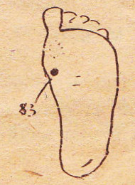

*Подошва: 83* (стор. 17) — точки: [83](83.md)

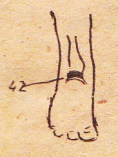

*Голеностоп: 42* (стор. 17) — точки: [42](42.md)

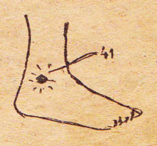

*Лодыжка: 41* (стор. 17) — точки: [41](41.md)

## Малюнки біля описів

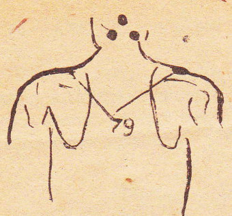

*Плечи: 79* (стор. 18) — точки: [79](79.md)

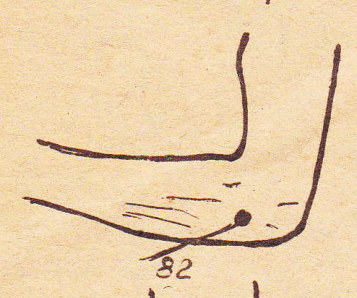

*Предплечье: 82* (стор. 18) — точки: [82](82.md)

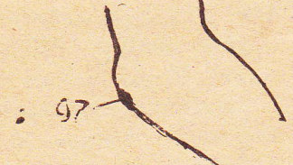

*Локоть: 97* (стор. 18) — точки: [97](97.md)

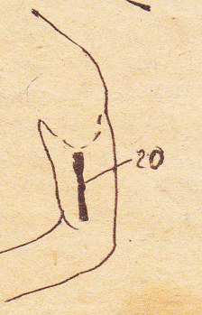

*Плечевая кость: 20* (стор. 18) — точки: [20](20.md)

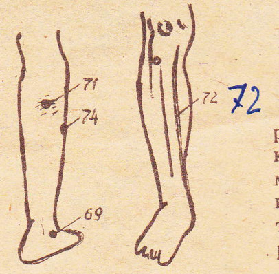

*Голень: 71, 74, 69, 72* (стор. 18) — точки: [71](71.md), [74](74.md), [69](69.md), [72](72.md)

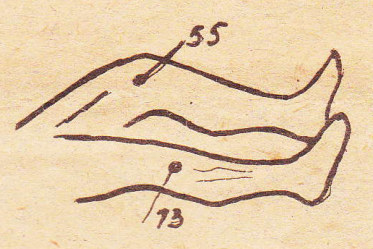

*Ноги: 55, 73* (стор. 18) — точки: [55](55.md), [73](73.md)

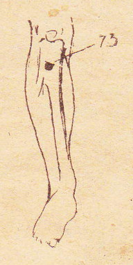

*Голень: 73* (стор. 18) — точки: [73](73.md)

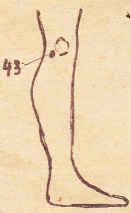

*Под коленом: 43* (стор. 18) — точки: [43](43.md)

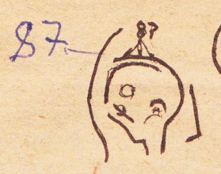

*Гребень бедренных костей: 87* (стор. 19) — точки: [87](87.md)

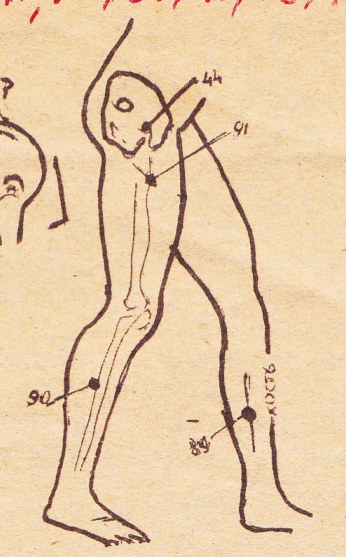

*Ноги: 44, 91, 90, 89* (стор. 19) — точки: [44](44.md), [91](91.md), [90](90.md), [89](89.md)

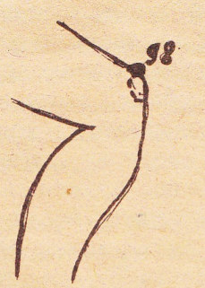

*Колено: 98* (стор. 19) — точки: [98](98.md)

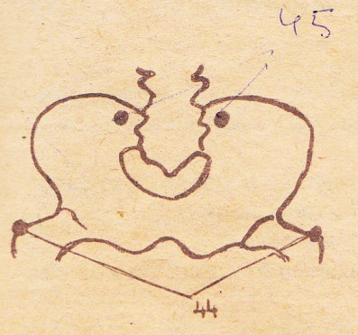

*Таз: 44 (от руки: 45)* (стор. 19) — точки: [44](44.md)

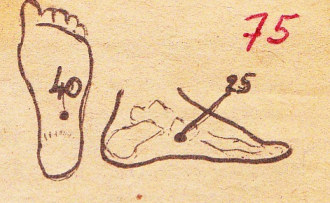

*Стопа: 40, 75* (стор. 19) — точки: [40](40.md), [75](75.md)

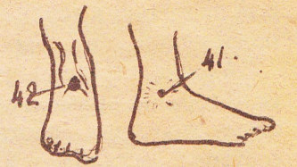

*Голеностоп: 42, 41* (стор. 19) — точки: [42](42.md), [41](41.md)

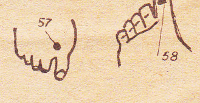

*Пальцы ног: 57, 58* (стор. 20) — точки: [57](57.md), [58](58.md)

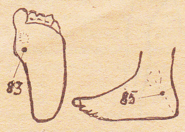

*Стопа: 83, 85* (стор. 20) — точки: [83](83.md), [85](85.md)
